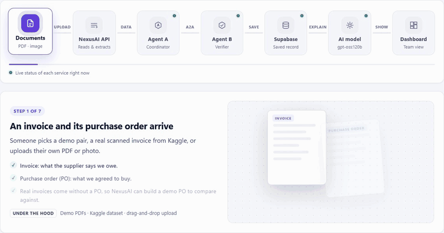
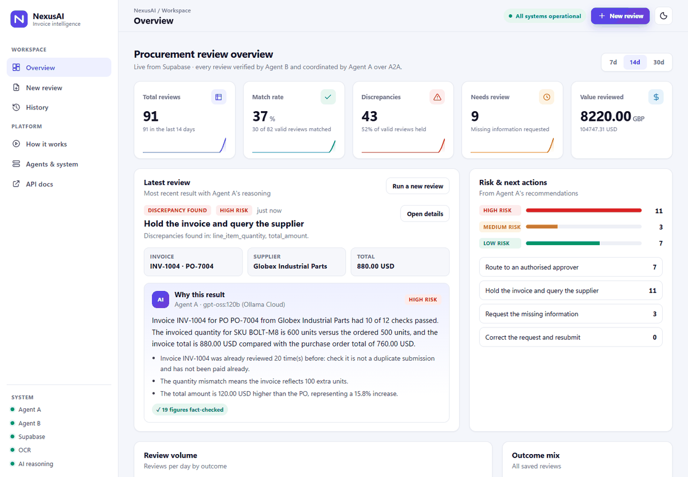
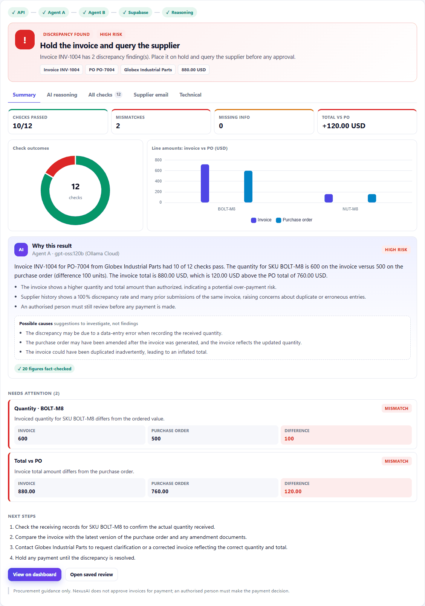
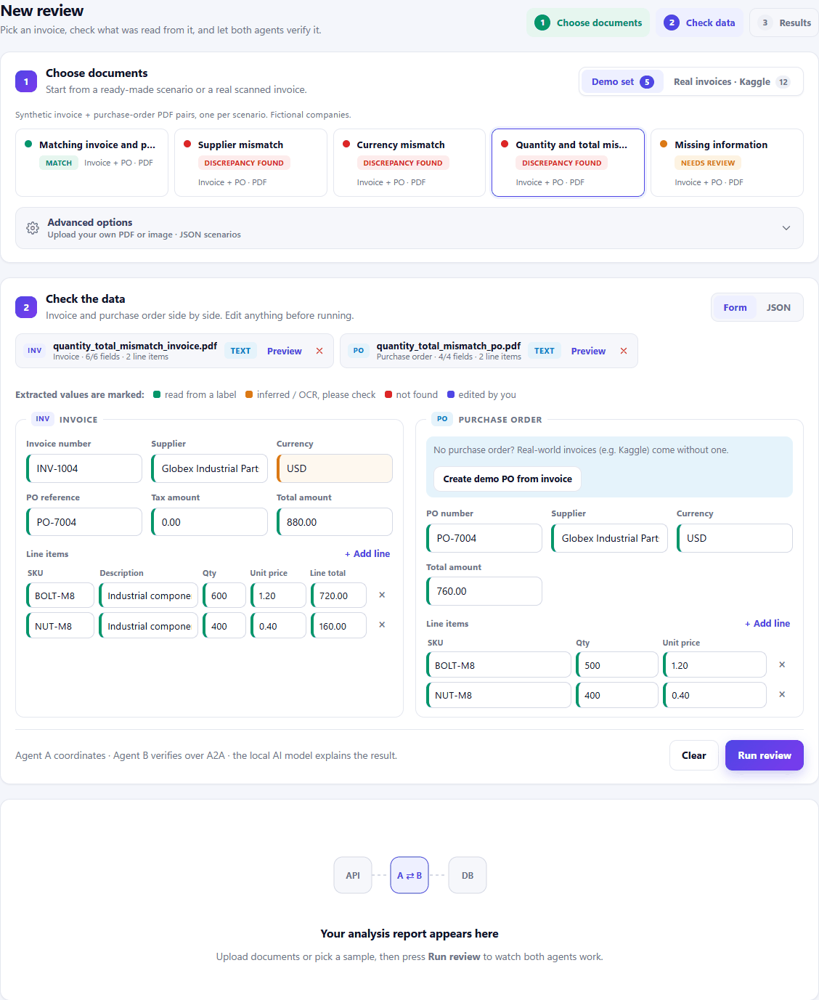
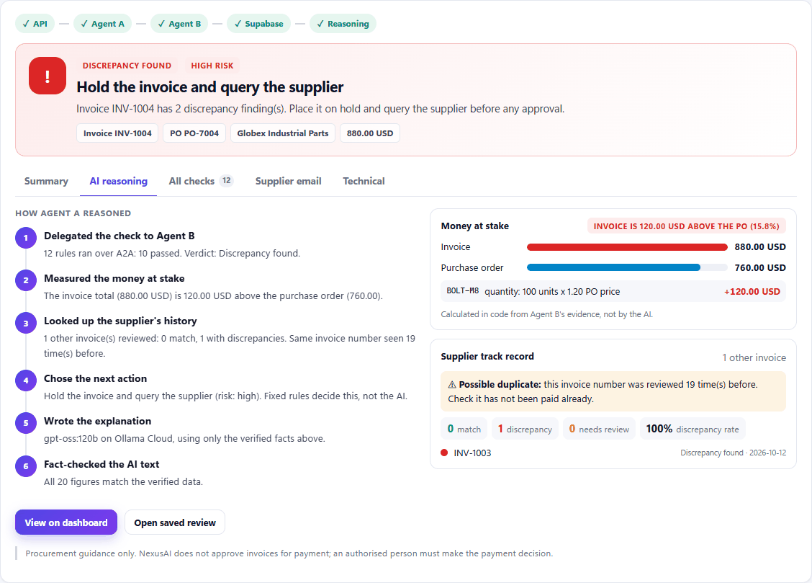
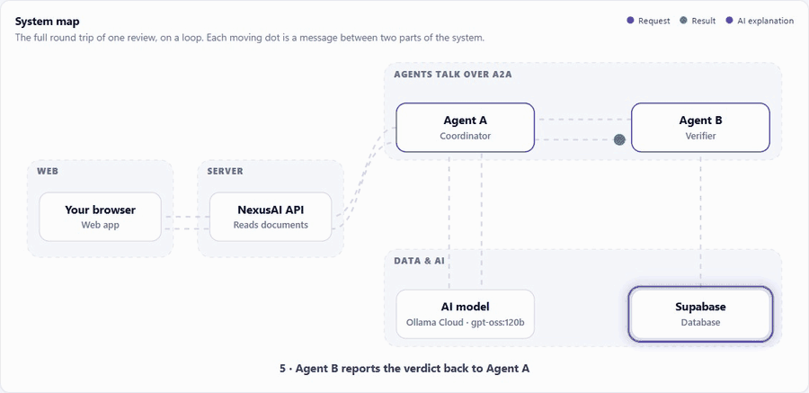

<div align="center">

# NexusAI

### A2A-powered invoice verification and procurement review

Two independent AI agents talk over the **Agent2Agent (A2A) protocol** to check every invoice
against its purchase order — exact rules decide, an AI model explains, and a person makes the
payment decision.




</div>

> **NexusAI never approves an invoice for payment.** Every result carries a disclaimer; the
> payment decision always belongs to an authorised person.

---

## Contents

1. [See it in action](#-see-it-in-action)
2. [How one review flows](#-how-one-review-flows)
3. [Quick start](#-quick-start)
4. [Project structure](#-project-structure)
5. [Configuration](#-configuration)
6. [Scripts, in the order you use them](#-scripts-in-the-order-you-use-them)
7. [Project brief coverage](#-project-brief-coverage)
8. [Documentation](#-documentation)
9. [Tech stack and credits](#-tech-stack-and-credits)

---

## 🎬 See it in action

<div align="center">

<sub><b>How it works</b> — the built-in walkthrough the team uses for demos (Slow / Normal speed)</sub>
</div>

<br>

| Overview dashboard | Analysis report |
|:---:|:---:|
|  |  |
| KPIs, latest review with Agent A's reasoning, risk & next actions | Verdict, charts, fact-checked AI explanation, findings, next steps |
| **Check the data** | **How Agent A reasoned** |
|  |  |
| Invoice and PO side by side, every value colour-marked | Reasoning timeline, money at stake, supplier track record |

<div align="center">

<br><sub><b>System map</b> — each moving dot is one message between two parts of the system</sub>
</div>

---

## 🔄 How one review flows

| Step | What happens | Where | Details |
|:---:|---|---|---|
| **1** | An invoice and its purchase order arrive — demo PDFs, real Kaggle scans, or your own upload. The API reads them (PDF text or **OCR**) into fields a person can check. | `backend/app/ingestion/` | [docs/1](docs/1-documents-and-ocr.md) |
| **2** | **Agent A — Procurement Coordinator** receives the request, discovers Agent B through its **Agent Card** and delegates the check over **A2A**. | `backend/app/agents/procurement_coordinator/` | [docs/2](docs/2-agent-a-and-a2a.md) |
| **3** | **Agent B — Invoice Verification Specialist** runs 9 kinds of check with exact `Decimal` arithmetic: `MATCH`, `DISCREPANCY_FOUND`, `NEEDS_REVIEW` or `INVALID_REQUEST`. No AI here. | `backend/app/agents/invoice_verifier/` | [docs/3](docs/3-agent-b-verification.md) |
| **4** | Agent B saves the result to **Supabase** (idempotent by task ID) for the audit trail. | `backend/app/persistence/` | [docs/4](docs/4-supabase.md) |
| **5** | Agent A measures the money at stake, looks up the supplier's history and asks the **AI model** to explain — every figure is **fact-checked**. | `reasoning.py`, `backend/app/llm/` | [docs/5](docs/5-ai-reasoning.md) |
| **6** | The **API** returns the report; the **web app** and dashboard update. | `backend/app/api/`, `frontend/` | [docs/6](docs/6-api-reference.md) · [docs/7](docs/7-web-app.md) |

| Agent | Role | Port | A2A skill |
|---|---|---|---|
| **Agent A** — Procurement Coordinator | Delegates, chooses the next action, explains | `10002` | `coordinate_invoice_review` |
| **Agent B** — Invoice Verification Specialist | Deterministic checks, saves every review | `10001` | `verify_invoice_against_po` |

The agents are **separate processes**: Agent A never imports Agent B's code — it knows Agent B
only through its published Agent Card and its A2A results.

---

## 🚀 Quick start

**Prerequisites:** Windows + PowerShell, Python 3.11, [Tesseract](https://github.com/UB-Mannheim/tesseract/wiki)
(for scans and photos), a Supabase project, an Ollama Cloud API key.

```powershell
# 1. Install
cd D:\NexusAI
python -m venv .venv
.\.venv\Scripts\Activate.ps1
python -m pip install -r backend\requirements.txt

# 2. Configure: copy the template and fill in your keys
copy backend\.env.example backend\.env

# 3. Create the database table (once): run both files in Supabase > SQL Editor
#    backend\supabase\migrations\001_create_verification_reviews.sql
#    backend\supabase\migrations\002_add_coordinator_reasoning.sql

# 4. Run everything — Agent B, Agent A, the API and the web app
python backend\run.py
```

It opens **<http://127.0.0.1:8080>**. All three services log into one terminal
(`[agent-b]`, `[agent-a]`, `[api]`); **Ctrl+C** stops them all. API docs: **/docs**.

<details>
<summary>Run each service in its own terminal instead</summary>

```powershell
cd D:\NexusAI\backend
python -m app.agents.invoice_verifier          # Agent B  :10001
python -m app.agents.procurement_coordinator   # Agent A  :10002
python -m app.api                              # API + web app  :8080
```
</details>

---

## 📁 Project structure

Folders are listed in the order a review travels through them.

```text
NexusAI/
├── README.md
├── docs/                                 ← detailed docs, numbered in process order
│   ├── 1-documents-and-ocr.md  …  9-testing-and-verification.md
│   └── images/                           screenshots, GIFs, animated architecture
│
├── frontend/                             WEB APP (no build step, served by the API)
│   ├── index.html                        app shell and the six pages
│   ├── css/styles.css                    design system, light/dark, animations
│   ├── js/app.js                         router, theme, live status
│   ├── js/lib/                           api · dom · meta · charts helpers
│   ├── js/components/result.js           the analysis report
│   ├── js/views/                         overview · review · history · how · system
│   └── vendor/chart.umd.min.js           Chart.js 4.4.6 (MIT)
│
└── backend/                              ALL PYTHON CODE
    ├── run.py                            ▶ one command starts everything
    ├── requirements.txt
    ├── .env.example                      settings template (no secrets)
    │
    ├── app/
    │   ├── config.py                     reads .env (ports, URLs, keys, timeouts)
    │   ├── models/invoice.py             the data contract: request & result schemas
    │   │
    │   ├── ingestion/                    STEP 1 · documents in
    │   │   ├── pdf_extract.py            PDF / image → fields with confidence
    │   │   ├── ocr.py                    Tesseract: upright, upscale, read
    │   │   └── kaggle_import.py          real invoices from 4 Kaggle datasets
    │   │
    │   ├── protocol/                     A2A plumbing shared by both agents
    │   │   ├── server.py                 Agent Card + JSON-RPC routes
    │   │   └── client.py                 discover · send · wait · read artifacts
    │   │
    │   ├── agents/
    │   │   ├── procurement_coordinator/  STEP 2 · Agent A (coordinator)
    │   │   │   ├── agent_card.py · server.py · __main__.py
    │   │   │   ├── delegate.py           finds Agent B, delegates over A2A
    │   │   │   ├── coordination.py       verdict → recommended action
    │   │   │   ├── context.py            money at stake · supplier history
    │   │   │   ├── reasoning.py          AI explanation + guardrails + fact check
    │   │   │   └── executor.py           the task lifecycle
    │   │   └── invoice_verifier/         STEP 3 · Agent B (verifier)
    │   │       ├── agent_card.py · server.py · __main__.py
    │   │       ├── verification.py       the rules (pure Python, no network)
    │   │       ├── money.py              Decimal & rounding per currency
    │   │       └── executor.py           the task lifecycle + save
    │   │
    │   ├── persistence/reviews.py        STEP 4 · Supabase read / write
    │   ├── llm/client.py                 STEP 5 · AI model client (Ollama Cloud …)
    │   └── api/                          STEP 6 · FastAPI gateway for the web app
    │       ├── main.py · __main__.py     app factory, CORS, limits / start
    │       ├── routes.py · schemas.py    endpoints and response models
    │       └── gateway.py                calls Agent A over A2A
    │
    ├── scripts/                          command-line tools, numbered in order of use
    ├── samples/
    │   ├── json/                         6 synthetic scenarios
    │   ├── pdfs/                         10 synthetic invoice + PO PDFs
    │   └── kaggle/                       downloaded real invoices (git-ignored)
    └── supabase/migrations/              001 table · 002 Agent A's reasoning
```

---

## ⚙️ Configuration

Everything lives in `backend/.env` (git-ignored); `backend/.env.example` is the template.
Every value except the keys has a working default.

| Group | Variables | Notes |
|---|---|---|
| **Supabase** | `SUPABASE_URL`, `SUPABASE_SECRET_KEY` | Secret key (`sb_secret_…`); backend only |
| **AI model** | `LLM_PROVIDER`, `OLLAMA_URL`, `OLLAMA_API_KEY`, `LLM_MODEL`, `LLM_FALLBACK_MODEL` | Default: Ollama Cloud `gpt-oss:120b`, fallback `gemma4:31b` — [other providers](docs/5-ai-reasoning.md#providers-environment-variables-only-no-code-change) |
| **Kaggle** | `KAGGLE_API_KEY` | Only for the *Real invoices* tab |
| **OCR** | `TESSERACT_CMD` | Only if Tesseract isn't on `PATH` |
| **Ports & URLs** | `AGENT_B_PORT` (10001), `AGENT_A_PORT` (10002), `API_PORT` (8080), `AGENT_B_URL`, `AGENT_A_URL` | Defaults work locally |
| **Limits** | `API_CORS_ORIGINS`, `MAX_REQUEST_BYTES`, `DELEGATION_TIMEOUT_SECONDS`, `API_REQUEST_TIMEOUT_SECONDS`, `LLM_TIMEOUT_SECONDS` | Safe defaults |

Secrets are never logged, never sent to the browser and never committed.

---

## 🧰 Scripts, in the order you use them

Run from `backend/` with the virtual environment active.

| # | Script | When |
|:---:|---|---|
| 1 | `python scripts\1_check_supabase.py` | After setup: live write → read → duplicate check → cleanup |
| 2 | `python scripts\2_generate_sample_pdfs.py` | Rebuild the 10 demo PDFs from `samples/json/` |
| 3 | `python scripts\3_import_kaggle_samples.py --dataset grocery` | Load a random set of real invoices (`--evaluate` scores OCR) |
| 4 | `python scripts\4_send_verification_task.py --agent coordinator --brief` | Send all 6 scenarios over A2A (Agent A → Agent B) |
| 5 | `python scripts\5_get_verification_review.py --task-id <ID>` | Read a saved review from Supabase |

---

## ✅ Project brief coverage

| Brief requirement | Status | Where |
|---|:---:|---|
| Official A2A Python SDK, real A2A communication (no plain function calls) | ✅ | `app/protocol/`, both agents |
| Agent B: Agent Card, deterministic checks, structured findings, mismatch ≠ missing | ✅ | [docs/3](docs/3-agent-b-verification.md) |
| Decimal arithmetic, explicit currency & rounding assumptions | ✅ | `money.py` |
| Never claims an invoice is approved for payment | ✅ | disclaimer + AI guardrail |
| A2A test client: discover, submit, retrieve, print | ✅ | `scripts/4_send_verification_task.py` |
| Supabase: migration, secure keys, idempotent upsert, explicit errors | ✅ | [docs/4](docs/4-supabase.md) |
| Retrieve a saved review by task ID | ✅ | `scripts/5_get_verification_review.py` |
| Phase 2 — Agent A discovers Agent B and delegates over A2A | ✅ | [docs/2](docs/2-agent-a-and-a2a.md) |
| Phase 3 — PDF ingestion, OCR, uncertain fields shown explicitly | ✅ | [docs/1](docs/1-documents-and-ocr.md) |
| Phase 4 — LLM explanations; rules keep the arithmetic | ✅ | [docs/5](docs/5-ai-reasoning.md) — Ollama Cloud by default, Hugging Face supported |
| Phase 5 — RAG over procurement policies | ⏳ optional | not needed so far |
| Phase 6 — professional HTML/CSS/JS dashboard | ✅ | [docs/7](docs/7-web-app.md) |
| Phase 7 — deployment | ⏳ next | [docs/8](docs/8-deployment.md) |
| Automated tests | ✅ run, then removed | 150 passed; kept out of the repo by choice — [docs/9](docs/9-testing-and-verification.md) |

---

## 📚 Documentation

| # | Document | Covers |
|:---:|---|---|
| 1 | [Documents and OCR](docs/1-documents-and-ocr.md) | PDF extraction, Tesseract OCR, the four Kaggle datasets |
| 2 | [Agent A and A2A](docs/2-agent-a-and-a2a.md) | Delegation sequence, task states, `procurement_review` |
| 3 | [Agent B verification](docs/3-agent-b-verification.md) | Request schema, checks, results, rounding, scenarios |
| 4 | [Supabase](docs/4-supabase.md) | Migrations, table, saving rules, reading reviews |
| 5 | [AI reasoning](docs/5-ai-reasoning.md) | Guardrails, fact check, providers |
| 6 | [API reference](docs/6-api-reference.md) | Every endpoint and how the API protects the system |
| 7 | [Web app](docs/7-web-app.md) | Pages, report tabs, code layout |
| 8 | [Deployment](docs/8-deployment.md) | Vercel + Docker host + Supabase + Ollama Cloud |
| 9 | [Testing and verification](docs/9-testing-and-verification.md) | What was tested, results, known limitations |

---

## 🧱 Tech stack and credits

| Layer | Technology |
|---|---|
| Agents | [A2A Python SDK](https://a2a-protocol.org/) 1.2.2 · Starlette · Uvicorn |
| API | FastAPI 0.143 · Pydantic 2 · httpx |
| Documents | pdfplumber · pypdfium2 · Pillow · Tesseract 5 · fpdf2 (demo PDFs) |
| Data | Supabase (PostgreSQL, RLS) |
| AI | Ollama Cloud (`gpt-oss:120b`, `gemma4:31b`); local Ollama, Groq, Hugging Face supported |
| Frontend | HTML · CSS · JavaScript modules · Chart.js 4.4.6 |

**Datasets** (downloaded at runtime, not redistributed in this repo):
*High-Quality Invoice Images for OCR* by osamahosamabdellatif (ODbL) ·
*clearOCR Invoice Document AI* by clearOCR, derived from Kozlowski & Weichbroth (2021),
*Samples of electronic invoices*, Mendeley Data, DOI 10.17632/tnj49gpmtz.2 (CC BY 4.0) ·
*Synthetic Invoice OCR Dataset* by nowshinaranini (CC BY 4.0) ·
*Indian Grocery Tax Invoice Image Dataset* by surajitsadhukhan (CC BY 4.0).
All demo companies and figures in `backend/samples/` are fictional.
