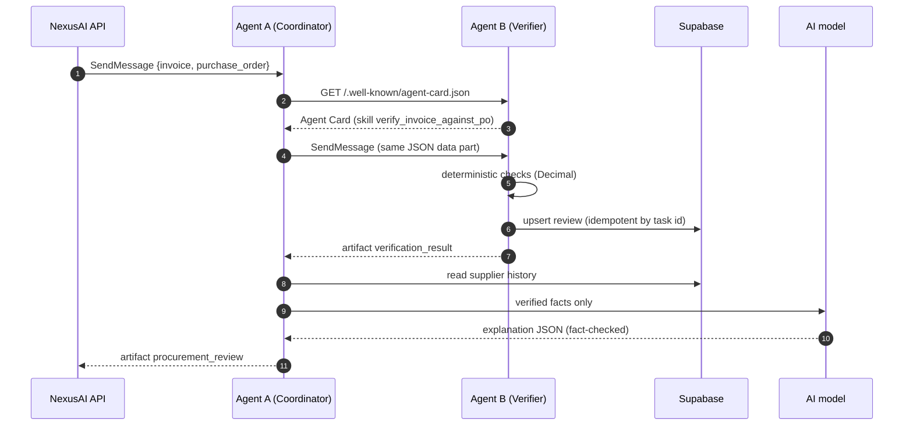

# 2 · Agent A and the A2A protocol

[← 1 · Documents](1-documents-and-ocr.md) · [README](../README.md) · Next: [3 · Agent B](3-agent-b-verification.md)

**Agent A, the Procurement Coordinator** (`:10002`), receives a review request and decides
nothing about numbers itself. It discovers **Agent B** through its public Agent Card,
delegates the verification over **A2A**, then turns Agent B's findings into a procurement next
step and a plain-language explanation.

The agents are separate processes and separate A2A participants. Agent A never imports Agent
B's code: it knows Agent B only through its Agent Card and its A2A results.

Code: [`backend/app/agents/procurement_coordinator/`](../backend/app/agents/procurement_coordinator/)
and the shared plumbing in [`backend/app/protocol/`](../backend/app/protocol/)

| File | Job |
|---|---|
| `agent_card.py` | Agent A's public card: name, version, skill `coordinate_invoice_review` |
| `delegate.py` | Discover Agent B, check it offers `verify_invoice_against_po`, send the task |
| `coordination.py` | Pure logic: verification result → recommended action + summary |
| `context.py` | Money at stake and supplier history (computed in code) |
| `reasoning.py` | AI explanation with guardrails and fact check ([doc 5](5-ai-reasoning.md)) |
| `executor.py` | The A2A task lifecycle: working → delegate → reason → artifact → done |
| `server.py`, `__main__.py` | Build and run the A2A server |
| `protocol/client.py` | Generic A2A client: discover, send, wait with `GetTask`, read artifacts |
| `protocol/server.py` | Generic A2A server: Agent Card route, JSON-RPC route, body-size limit |

## The delegation, step by step



## A2A behaviour (a2a-sdk 1.2.2, both agents)

- **Transport:** JSON-RPC 2.0 over HTTP at `POST /`, protocol version `1.0`.
- **Discovery:** `GET /.well-known/agent-card.json`.
- **Capabilities:** no streaming, no push notifications. A non-streaming `SendMessage` returns
  once the task has finished; `GetTask` retrieves it later.

| | `COMPLETED` | `REJECTED` | `FAILED` |
|---|---|---|---|
| **Agent B** | `MATCH`, `DISCREPANCY_FOUND`, `NEEDS_REVIEW` | `INVALID_REQUEST` | internal error |
| **Agent A** | Agent B completed | Agent B rejected it, or the request isn't one JSON data part | Agent B unreachable, missing the skill, or failed |

## Recommended actions

| Agent B result | Agent A action | Risk |
|---|---|---|
| `MATCH` | `ROUTE_TO_APPROVER` | low |
| `DISCREPANCY_FOUND` | `HOLD_AND_QUERY_SUPPLIER` | high |
| `NEEDS_REVIEW` | `REQUEST_MISSING_INFORMATION` | medium |
| `INVALID_REQUEST` | `CORRECT_AND_RESUBMIT` | medium |

Fixed rules choose the action and the risk level; the AI never does.

## Agent A output: artifact `procurement_review`

```json
{
  "recommended_action": "HOLD_AND_QUERY_SUPPLIER",
  "verification_result": "DISCREPANCY_FOUND",
  "invoice_number": "INV-1004",
  "po_number": "PO-7004",
  "summary": "Invoice INV-1004 has 2 discrepancy finding(s). Place it on hold and query the supplier before any approval.",
  "action_items": ["..."],
  "delegation": {
    "agent": "NexusAI Invoice Verification Specialist",
    "agent_url": "http://127.0.0.1:10001",
    "skill": "verify_invoice_against_po",
    "task_id": "87ccf9b5-...",
    "task_state": "TASK_STATE_COMPLETED",
    "persistence": {"status": "saved", "review_id": "..."}
  },
  "verification": {"...": "Agent B's full verification_result"},
  "reasoning": {"...": "see doc 5"},
  "disclaimer": "Procurement guidance only. NexusAI does not approve invoices for payment; ..."
}
```

## Try it from the command line

```powershell
cd backend
python scripts\4_send_verification_task.py --agent coordinator --brief   # Agent A -> Agent B, 6 scenarios
python scripts\4_send_verification_task.py --brief                       # Agent B directly
python scripts\4_send_verification_task.py --list                        # list scenarios
```

Agent Cards: <http://127.0.0.1:10002/.well-known/agent-card.json> (A) ·
<http://127.0.0.1:10001/.well-known/agent-card.json> (B)
