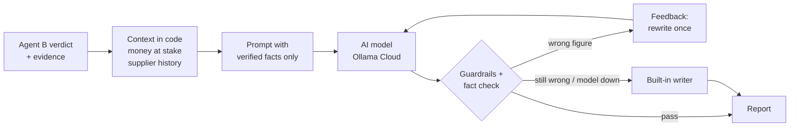

# 5 · AI reasoning: explain, never decide

[← 4 · Supabase](4-supabase.md) · [README](../README.md) · Next: [6 · API](6-api-reference.md)

After Agent B has decided, Agent A explains the result for a procurement officer. **The rules
decide; the model only explains.**

Code: [`reasoning.py`](../backend/app/agents/procurement_coordinator/reasoning.py) ·
[`context.py`](../backend/app/agents/procurement_coordinator/context.py) ·
[`backend/app/llm/client.py`](../backend/app/llm/client.py)

## What Agent A adds (`reasoning` block)

| Field | From | Meaning |
|---|---|---|
| `explanation` | AI | What was found: invoice, PO, supplier, checks passed, exact differing values |
| `risk_points` | AI | 2–4 short bullet points |
| `likely_causes` | AI | Neutral possibilities, shown as *suggestions to investigate, not findings* |
| `next_steps` | AI | What the officer should do, in order |
| `supplier_email` | AI | Draft query — only for `DISCREPANCY_FOUND` / `NEEDS_REVIEW` |
| `risk_level` | rules | `low` / `medium` / `high`, from the verdict, never from the model |
| `financial_impact` | code | Invoice vs PO total and the money effect of each line mismatch (never across currencies) |
| `supplier_history` | Supabase | The supplier's other invoices and **possible duplicates** (same invoice number seen before) |
| `fact_check` | code | Figures verified, and whether a correction round was needed |
| `trace` | code | The steps Agent A took — shown as *How Agent A reasoned* |
| `source` | — | `llm` (with `model`, `provider`) or `built_in` (with `fallback_reason`) |

## Guardrails

- **Facts only:** the model receives only verified facts and must return strict JSON.
- **Fact check with self-correction:** every number in the AI text must appear in the verified
  data, and a currency symbol must match the invoice currency. If not, the model is told exactly
  what was wrong and gets **one** rewrite; if it still fails, the built-in writer is used.
- **No payment decisions:** text that approves or authorises payment is rejected.
- **Neutral wording:** "difference" or "above the purchase order", never "overcharge".
- **Never blocks a review:** if the model, the history lookup or the fact check fails, the
  review still completes with the built-in writer and the reason is shown.

## Providers (environment variables only, no code change)

| Provider | Settings | Notes |
|---|---|---|
| **Ollama Cloud** (default) | `LLM_PROVIDER=ollama`, `OLLAMA_URL=https://ollama.com`, `OLLAMA_API_KEY`, `LLM_MODEL=gpt-oss:120b`, `LLM_FALLBACK_MODEL=gemma4:31b` | Free tier; ~3–6 s per review; works after deployment |
| Local Ollama | leave `OLLAMA_URL` unset, `ollama pull qwen2.5:3b`, `LLM_MODEL=qwen2.5:3b` | Offline; data never leaves the PC; ~5–20 s |
| Groq / OpenAI-compatible | `LLM_PROVIDER=openai`, `LLM_BASE_URL`, `LLM_API_KEY` | Free tier with rate limits |
| Hugging Face | `LLM_PROVIDER=huggingface`, `HF_TOKEN` | Needs account credits |
| None | `LLM_ENABLED=false` | Built-in writer only |

The fallback model is tried automatically when the main one is rate-limited, out of credits or
unavailable. Hosted "thinking" models get a 3000-token budget so their JSON answer is not cut off.

Startup log: `AI reasoning: Ollama Cloud model gpt-oss:120b is ready (fallback: gemma4:31b).`
