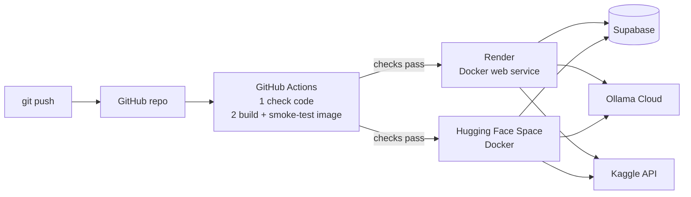

# 8 · Deployment: Docker, CI/CD, Render and Hugging Face Spaces

[← 7 · Web app](7-web-app.md) · [README](../README.md) · Next: [9 · Testing](9-testing-and-verification.md)

NexusAI ships as **one Docker image** that runs Agent B, Agent A, the API and the web app, with
Tesseract OCR inside. The same image runs on Render, Hugging Face Spaces, Railway or Fly.io.
One URL serves everything, so no separate frontend host is needed.



## The container

| File | What it does |
|---|---|
| [`Dockerfile`](../Dockerfile) | Python 3.11 slim + `tesseract-ocr`; installs `requirements.txt`; runs `backend/run.py --no-browser` as a normal user (uid 1000) |
| [`.dockerignore`](../.dockerignore) | Keeps `.env`, `.venv`, `.git`, docs and downloaded Kaggle images out of the image |

- **Port:** the API listens on `$PORT` — Render sets it, Hugging Face uses `7860` (the default).
- **Size / memory:** image ~530 MB; ~220 MB RAM idle, ~250 MB during OCR (fits free 512 MB plans).
- **Stops cleanly** on `docker stop` (all three services shut down in order).

Try it locally with Docker Desktop:

```powershell
docker build -t nexusai .
docker run --rm -p 7860:7860 -e ACCESS_PASSWORD=choose-one -e SUPABASE_URL=... -e SUPABASE_SECRET_KEY=... -e OLLAMA_API_KEY=... -e KAGGLE_API_KEY=... nexusai
# open http://localhost:7860
```

Don't pass `API_HOST`, `API_PORT` or `TESSERACT_CMD` to the container — the image sets them.

## Environment variables on the host

| Variable | Value |
|---|---|
| `SUPABASE_URL`, `SUPABASE_SECRET_KEY` | from Supabase → Project Settings → API Keys |
| `OLLAMA_API_KEY` | from ollama.com → Settings → Keys |
| `LLM_PROVIDER` `OLLAMA_URL` `LLM_MODEL` `LLM_FALLBACK_MODEL` | `ollama` · `https://ollama.com` · `gpt-oss:120b` · `gemma4:31b` |
| `KAGGLE_API_KEY` | from kaggle.com → Settings → API |
| `ACCESS_PASSWORD` | the password you give your team (see below) |

`TRUST_PROXY_HEADERS=true` is already set in the image. Secrets live only in the host's settings —
never in GitHub.

## CI/CD with GitHub Actions

[`.github/workflows/ci.yml`](../.github/workflows/ci.yml) runs on every push and pull request:

1. **Check code** — Python compiles, lint finds no errors, every module imports, JavaScript parses.
2. **Build and smoke-test the container** — builds the image, starts it with a test password and no
   secrets, checks the password is enforced, sends four scenarios through **Agent A → Agent B over
   A2A** (`MATCH`, `DISCREPANCY_FOUND`, `NEEDS_REVIEW`, `INVALID_REQUEST`) and extracts a PDF.
3. **Deploy to Hugging Face** — only on `main`, and only when the Space is configured (below).

A failed check stops the deployment, so a broken commit never goes live.

## Option 1 · Render (free web service)

1. Render dashboard → **New → Web Service** → connect the GitHub repo `NexusAI`.
2. **Language:** Docker · **Branch:** `main` · **Instance type:** Free.
3. **Environment variables:** the table above.
4. **Advanced → Health check path:** `/api/health`.
5. **Advanced → Auto-Deploy:** *After CI checks pass*.
6. Create. The app is at `https://<service-name>.onrender.com`.

Every push to `main` then redeploys automatically once CI is green. The free plan sleeps after
~15 minutes idle; the first visit afterwards takes ~50 s to wake up.

## Option 2 · Hugging Face Space (free, 16 GB RAM)

1. huggingface.co → **New Space** → name `NexusAI`, **SDK: Docker** (blank template), public or private.
2. Space → **Settings → Variables and secrets:** add the variables from the table above as *secrets*.
3. huggingface.co → **Settings → Access Tokens:** create a token with **write** access.
4. GitHub repo → **Settings → Secrets and variables → Actions:**
   - secret `HF_TOKEN` = that token
   - variable `HF_SPACE` = `BaranikumarNagarajan/NexusAI`
5. Push to `main` (or run the workflow by hand). The **Deploy to Hugging Face Space** job pushes
   the app; the Space builds it and serves it at
   `https://baranikumarnagarajan-nexusai.hf.space`.

The job adds the Space settings (`sdk: docker`, `app_port: 7860`) to the README it pushes and
stores PDFs and images with Git LFS, as the Hub requires. A free Space sleeps after 48 hours
without visitors.

## Sharing with your team

Send the app link **and** the access password (ideally by a different channel, e.g. the link in
the team chat and the password in a direct message). Everyone stays signed in for 12 hours. To
revoke access, change `ACCESS_PASSWORD` on the host — that signs everyone out.

## Optional: frontend on Vercel

Not needed (the container already serves the web app), but possible: import the repo in Vercel
with **Root directory** `frontend` and no build command, set `apiBase` in
[`frontend/config.js`](../frontend/config.js) to the backend URL, and add the Vercel address to
the backend's `API_CORS_ORIGINS`.

## Good to know

- Downloaded Kaggle images live on the container's temporary disk; **↻ Refresh** downloads a new
  set after a redeploy. The demo PDFs are part of the image.
- Rate limits and sign-in tokens are kept in memory; a restart resets the counters.
