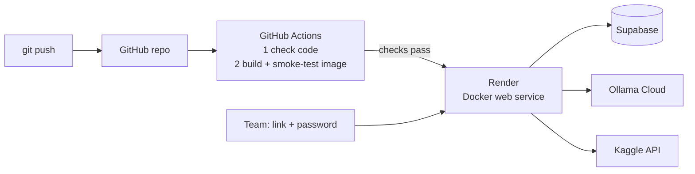

# 8 · Deployment: Docker, CI/CD and Render

[← 7 · Web app](7-web-app.md) · [README](../README.md) · Next: [9 · Testing](9-testing-and-verification.md)

NexusAI ships as **one Docker image** that runs Agent B, Agent A, the API and the web app, with
Tesseract OCR inside. It is deployed on **Render**: **<https://nexusai-wnn7.onrender.com>**
(sign-in required). One URL serves everything, so no separate frontend host is needed. The same
image also runs on Hugging Face Spaces, Railway or Fly.io.



## The container

| File | What it does |
|---|---|
| [`Dockerfile`](../Dockerfile) | Python 3.11 slim + `tesseract-ocr`; installs `requirements.txt`; runs `backend/run.py --no-browser` as a normal user (uid 1000) |
| [`.dockerignore`](../.dockerignore) | Keeps `.env`, `.venv`, `.git`, docs and downloaded Kaggle images out of the image |

- **Port:** the API listens on `$PORT` — Render sets it; `7860` otherwise.
- **Size / memory:** image ~530 MB; ~210 MB RAM idle, ~420 MB peak with three Kaggle refreshes and
  background OCR together (measured under a 512 MB limit). OCR runs one job at a time at low CPU
  priority, and `MALLOC_ARENA_MAX=2` stops per-thread memory pools — without these a 512 MB plan
  ran out of memory and restarted (seen on Render as HTTP 502).
- **OCR speed on small CPUs:** Render's free plan has a fraction of one CPU. Tesseract runs with
  one thread (`OMP_THREAD_LIMIT=1`, ~4× faster there: 63 s → 17 s a page), and orientation
  detection only runs when a page reads as noise (sideways photos). Expect ~15–30 s per scanned
  invoice online (sideways phone photos up to 2–3 minutes), a few seconds locally.
- **Stops cleanly** on `docker stop` (all three services shut down in order).

Try it locally with Docker Desktop:

```powershell
docker build -t nexusai .
docker run --rm -p 7860:7860 -e ACCESS_PASSWORD=choose-one -e SUPABASE_URL=... -e SUPABASE_SECRET_KEY=... -e OLLAMA_API_KEY=... -e KAGGLE_API_KEY=... nexusai
# open http://localhost:7860
```

Don't pass `API_HOST`, `API_PORT` or `TESSERACT_CMD` to the container — the image sets them.

## Environment variables on the host

| Variable | Value |
|---|---|
| `SUPABASE_URL`, `SUPABASE_SECRET_KEY` | from Supabase → Project Settings → API Keys |
| `OLLAMA_API_KEY` | from ollama.com → Settings → Keys |
| `LLM_PROVIDER` `OLLAMA_URL` `LLM_MODEL` `LLM_FALLBACK_MODEL` | `ollama` · `https://ollama.com` · `gpt-oss:120b` · `gemma4:31b` |
| `KAGGLE_API_KEY` | from kaggle.com → Settings → API |
| `ACCESS_PASSWORD` | the password you give your team (see below) |

`TRUST_PROXY_HEADERS=true` is already set in the image. Secrets live only in the host's settings —
never in GitHub.

## CI/CD with GitHub Actions

[`.github/workflows/ci.yml`](../.github/workflows/ci.yml) runs on every push and pull request:

1. **Check code** — Python compiles, lint finds no errors, every module imports, JavaScript parses.
2. **Build and smoke-test the container** — builds the image, starts it with a test password and no
   secrets, checks the password is enforced, sends four scenarios through **Agent A → Agent B over
   A2A** (`MATCH`, `DISCREPANCY_FOUND`, `NEEDS_REVIEW`, `INVALID_REQUEST`) and extracts a PDF.

Render waits for both checks; a failed check stops the deployment, so a broken commit never goes live.

## Render setup (free web service)

1. Render dashboard → **New → Web Service** → connect the GitHub repo `NexusAI`.
2. **Language:** Docker · **Branch:** `main` · **Instance type:** Free.
3. **Environment variables:** the table above.
4. **Advanced → Health check path:** `/api/live` (instant; `/api/health` also checks both agents
   and Supabase and can be slow while OCR is busy, which made Render restart a healthy app).
5. **Advanced → Auto-Deploy:** *After CI checks pass*.
6. Create. The app is at `https://<service-name>.onrender.com`.

Every push to `main` then redeploys automatically once CI is green. The free plan sleeps after
~15 minutes idle; the first visit afterwards takes ~50 s to wake up.

## Other hosts

The same image runs elsewhere without code changes — for example a **Hugging Face Docker Space**
(free, more memory; set `app_port: 7860` in the Space README and add the variables above as Space
secrets), Railway or Fly.io.

## Sharing with your team

Send the app link **and** the access password (ideally by a different channel, e.g. the link in
the team chat and the password in a direct message). Everyone stays signed in for 12 hours. To
revoke access, change `ACCESS_PASSWORD` on the host — that signs everyone out.

## Optional: frontend on Vercel

Not needed (the container already serves the web app), but possible: import the repo in Vercel
with **Root directory** `frontend` and no build command, set `apiBase` in
[`frontend/config.js`](../frontend/config.js) to the backend URL, and add the Vercel address to
the backend's `API_CORS_ORIGINS`.

## Good to know

- Downloaded Kaggle images live on the container's temporary disk; **↻ Refresh** downloads a new
  set after a redeploy. The demo PDFs are part of the image.
- Rate limits and sign-in tokens are kept in memory; a restart resets the counters.
