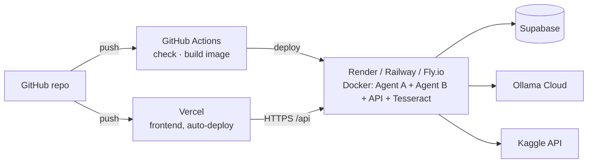

# 8 · Deployment plan

[← 7 · Web app](7-web-app.md) · [README](../README.md) · Next: [9 · Testing](9-testing-and-verification.md)

> Status: planned. Docker and CI/CD files are added in the deployment step.

## Where each part runs

| Part | Host | Why |
|---|---|---|
| Frontend (static files) | **Vercel** | Free, fast, redeploys automatically on every push to GitHub |
| Backend (3 long-running services + Tesseract) | **Render / Railway / Fly.io** via Docker | Vercel's short-lived functions can't keep A2A agents running or install Tesseract |
| Database | **Supabase** | Already hosted |
| AI model | **Ollama Cloud** | Already the default; no local machine needed |

## Docker and Tesseract

Tesseract is a program, not a Python package. In the container it is installed by the
Dockerfile (`apt-get install tesseract-ocr`, which includes English and orientation detection),
and the code finds it on `PATH` automatically — `TESSERACT_CMD` is not needed.

## Protect the public demo

Set `ACCESS_PASSWORD` (and `TRUST_PROXY_HEADERS=true`) on the backend host. Visitors then sign in
before anything runs, and rate limits cap reviews, Kaggle downloads, OCR and login attempts, so
the Ollama, Kaggle and Supabase quotas can't be used up — see
[Access password and rate limits](6-api-reference.md#access-password-and-rate-limits).

## Frontend → backend address

When the frontend is on Vercel and the backend elsewhere, set the backend URL in
`frontend/config.js` (`apiBase: "https://<your-backend>"`) and add the Vercel address to the
backend's `API_CORS_ORIGINS`. When one container serves both, leave `apiBase` empty.

## Secrets

`SUPABASE_URL`, `SUPABASE_SECRET_KEY`, `OLLAMA_API_KEY`, `KAGGLE_API_KEY` and `ACCESS_PASSWORD` are set in the
backend host's environment settings — never in GitHub. `backend/.env` is git-ignored. The
frontend needs no secrets. The backend's `API_CORS_ORIGINS` must include the Vercel domain.

## Good to know

- Downloaded Kaggle images live on the container's temporary disk; **↻ Refresh** downloads a
  new set after a redeploy. The demo PDFs are in the repo.
- Render's free plan sleeps after ~15 minutes idle; the first request then takes ~50 s.
